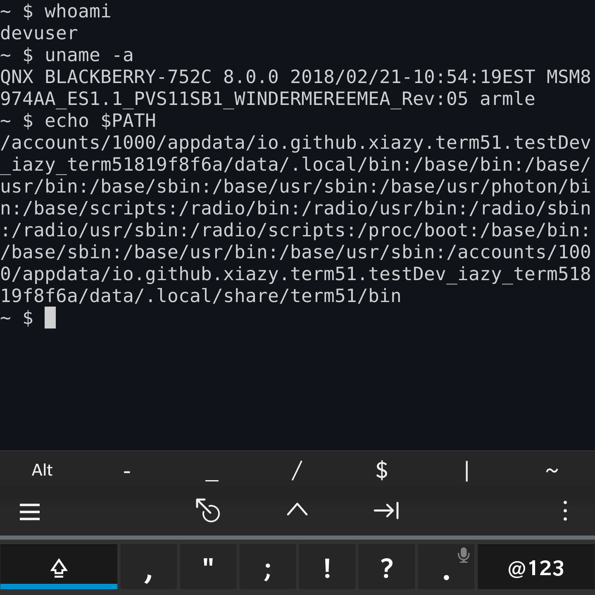
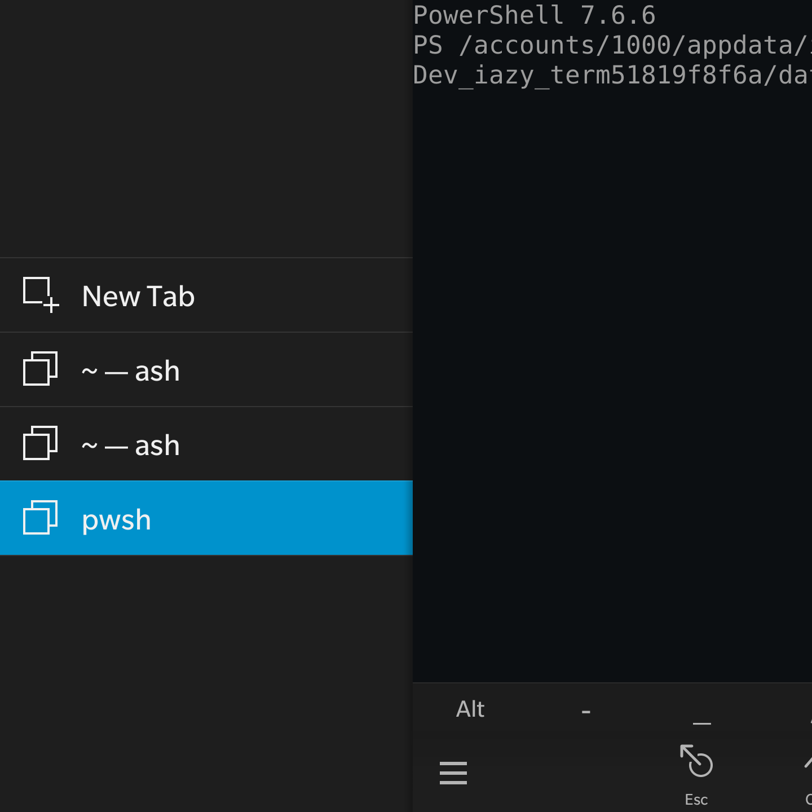
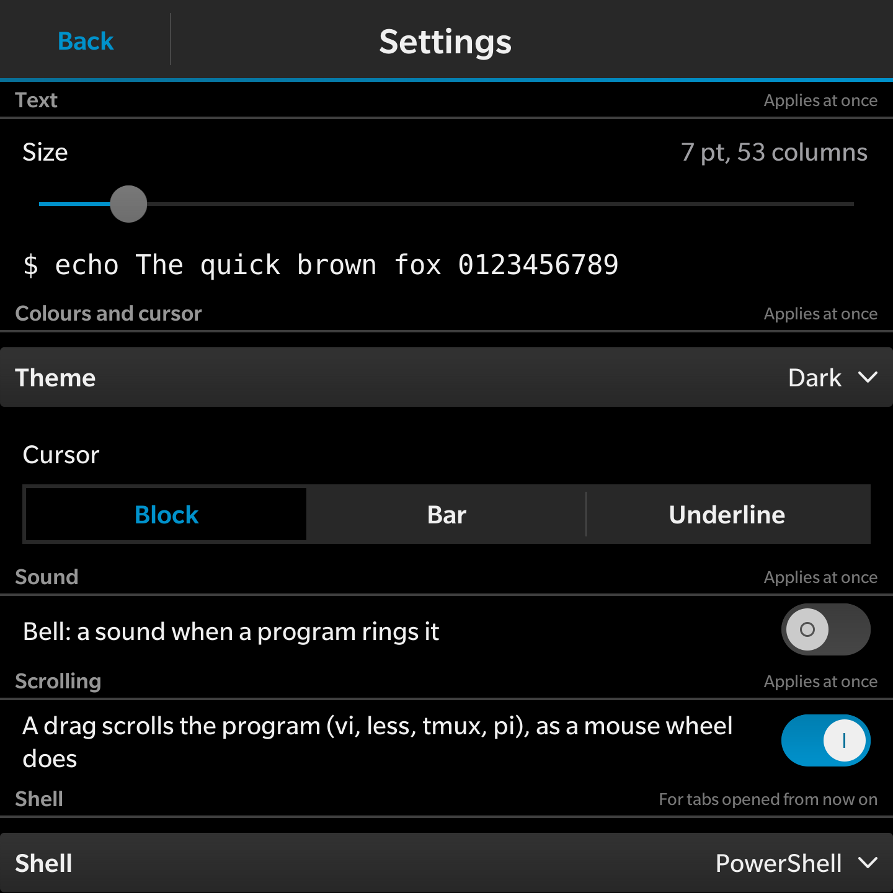
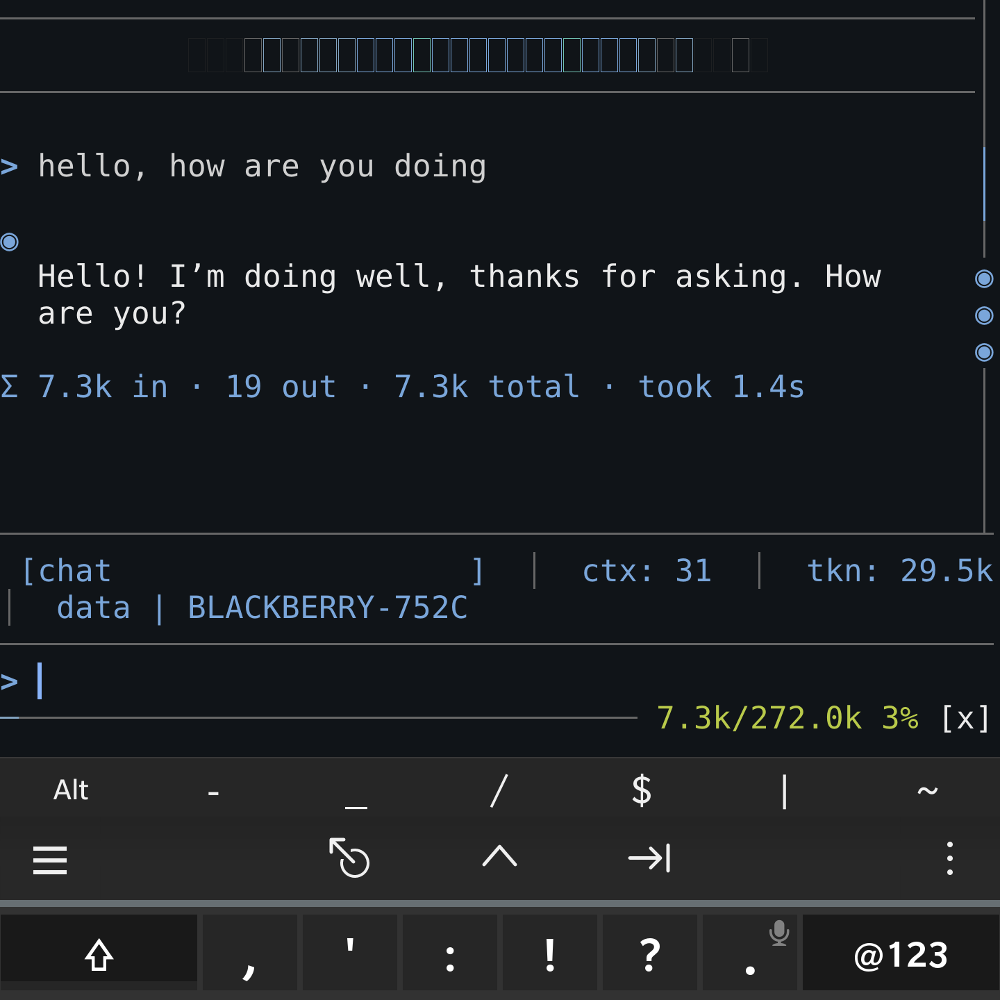

# term51

A terminal emulator for BlackBerry 10, written in Go with a Cascades UI.
The terminal core is [libghostty-vt-go](libghostty-vt-go/), a port of
libghostty-vt (the terminal emulation core of Ghostty, v1.3.1) to Go, kept
in this repository with its own history and the rules it was ported by.
The SSH client the app ships is Dropbear: upstream's 2026.94 release as the
submodule [third_party/dropbear](third_party/dropbear), with term51's changes
for QNX in [tools/dropbear](tools/dropbear/) (clone with `--recursive`, or
the build fetches it).

## Screenshots

A shell tab on a BlackBerry Passport, with the key strip above the phone's
keyboard; the tab list, where each tab is named by its folder and the program
in the foreground; Settings; and pi, a coding agent, running in a tab.

## Installing

The [latest release](https://github.com/XIAZY/term51/releases/latest) has the
package, `io.github.xiazy.term51.bar`, with its SHA-256 in the release notes.
It is an unsigned development-mode package.

- **On a phone rooted with bb10mt:** from a computer with ssh and scp, run
  [`tools/install.sh`](tools/install.sh) `root@<phone> io.github.xiazy.term51.bar`.
  The script stands alone, so a copy of it is enough: it copies the package
  over ssh and installs it with the phone's own installer, with no Development
  Mode, Java or BlackBerry SDK. To upgrade, close term51 first; the phone does
  not replace an open app.
- **In Development Mode:** BlackBerry's tools for installing development
  packages should take it, since it is unsigned, but this way has not been
  tried yet.

In the app, Settings, Shell, chooses the shell for new tabs: the phone's own,
BusyBox's ash from the app, or PowerShell. Settings, PowerShell, Download,
fetches PowerShell from the latest release of
[powershell-qnx](https://github.com/XIAZY/powershell-qnx), checked by its
SHA-256, into the app's own storage. The Dropbear SSH client is on every
shell's PATH as `ssh` and `scp`.

## Using term51

**Scrolling.** A vertical drag does what a mouse wheel does in a desktop
terminal. In a plain shell it moves the view back through what has scrolled
away. In a program that takes the whole screen (vi, less, man, pi, a coding
agent) it scrolls that program: the drag reaches it as wheel turns when the
program reads the mouse, and otherwise as Up and Down keys. tmux scrolls its
panes once its mouse is on (`set -g mouse on`). Settings, Scrolling, turns
this off: then a drag always moves the view.

## Layout (planned)

- `main.go`: keeps the main goroutine on the process's main thread for the
  Qt event loop and starts the app.
- `internal/ui`: the Cascades bridge (one C++ `QObject`) and the native window
  the terminal is drawn into (`ForeignWindowControl`).
- `internal/pty`: the pseudo-terminal and the shell.
- `internal/session`: one goroutine per terminal; feeds the shell's output to
  the library and key input back to the shell.
- `internal/render`: draws the library's render state into the window.
- `internal/replies`: the app's own answers to programs' queries.
- `assets/*.qml`: the pages.

## Workflow

`main` is the development line. Every change is made on its own feature
branch and merged into `main` only after review: the reviewer reads the diff
and reruns the tests.
